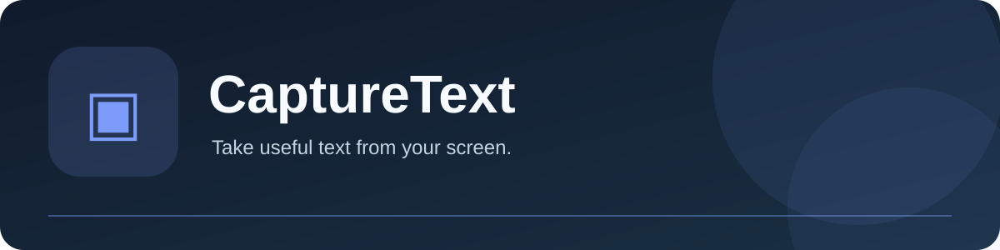
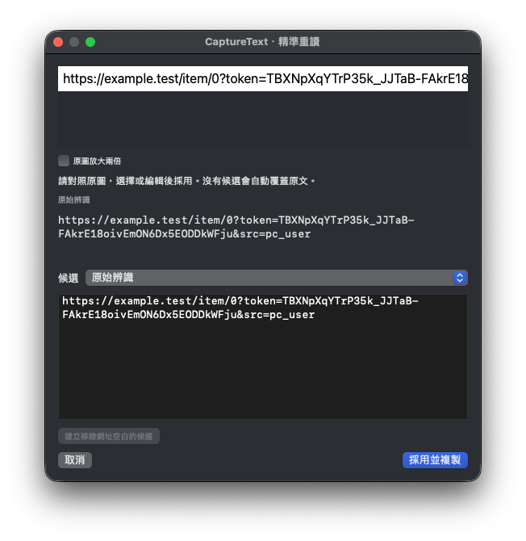

# CaptureText

[English](README.md) · [繁體中文](README.zh-Hant.md) · [**简体中文**](README.zh-Hans.md)



 

**从屏幕提取可用文字。** 个人 macOS 工具系列的独立 App。

## 主要功能

- 用本机 OCR 识别框选屏幕或导入图片。
- 朗读文字、扫描二维码，并在导出 CSV/XLSX 前校对表格。
- 有兼容设备时可使用 macOS 连续互通相机拍照或扫描。

## 精准 OCR

使用“精准框选”，或在两分钟内“精准重读上次图片”。小面板可对照原图、原样重读、小字放大及可选的原生 PaddleOCR 候选；编辑后按“采用并复制”。网址空白不再被静默移除，累积模式重读也不会重复添加。视频重读最多比较三张画面，不会合并不同字幕。

“设置 → 精准”可安装 Apple Silicon 第二引擎模型包（磁盘约 89 MB）。每次重读使用独立进程，完成即退出；不需要 Python、不上传图片。自动替换须通过真实独立样本验证，目前保持停用。[流程、限制及可复现评测](docs/ocr-precision.md)。



## 安装预览版

从 [Releases](https://github.com/yoko1234p/CaptureText/releases/tag/v0.10.0-preview.1) 下载 macOS ZIP，解压后将 `CaptureText.app` 移至“应用程序”。预览版使用临时签名，**未经 Apple 公证**。首次打开时在 Finder 右键选择“打开”；若系统阻止，请到“系统设置 → 隐私与安全性 → 仍要打开”核对。只授予所需权限，覆盖现用版本前先备份本地数据。

## 从源代码构建

```sh
cd DeskTools
APP_UI_LANGUAGE=zh-Hant swift test -j 4
bash Scripts/build.sh release
```

所需的本地 `Shared/` 包和构建工具已包含在仓库；构建不会自动安装或启动应用。

## 系统要求与限制

macOS 14 或更高版本；源代码构建需 Xcode 27／Swift 6 和 Python 3。 截取屏幕需要屏幕录制权限；图片文件 OCR 不需要。连续互通相机取决于附近设备、账户及网络条件。使用表格导出数据前请校对。

## 参与及授权

原创应用代码按 GPL-3.0-only 发布；附带的第三方及数据许可须分别保留。详见 [LICENSE](LICENSE)、[THIRD_PARTY_NOTICES.md](THIRD_PARTY_NOTICES.md)、[CONTRIBUTING.md](CONTRIBUTING.md) 和 [SECURITY.md](SECURITY.md)。
